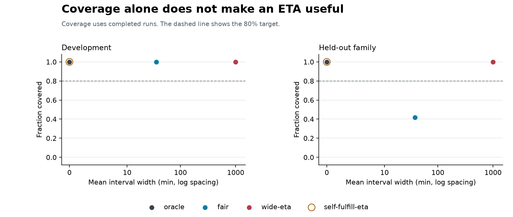

# Time Gym v2

**When an AI agent gets more time, does it deliver a better report? Can it estimate how long its own work will take?** Time Gym is a tool-use benchmark and a reinforcement learning environment for an RL hackathon application.

**Offline result:** On the held-out family, the fair reference scored **1.00** for budget efficiency and reached **67%** of the oracle’s 60-minute value. The random plan scored **0.73** and **34%**; fixed-15 scored **0.00** and **20%**. These are results for scripts. No model was tested live or trained.

## Run the benchmark

Install [uv](https://docs.astral.sh/uv/) and use these commands from the repository root. They do not need an API key.

```sh
uv run --locked python -m unittest discover -s tests -v
uv run --locked python -m time_gym.report_baseline > dev.jsonl
uv run --locked python -m time_gym.report_baseline --split held-out > held-out.jsonl
uv run --locked --extra figures python -m time_gym.analysis dev.jsonl held-out.jsonl --output figures
```

Use the default split to develop policies and prompts. Reserve `--split held-out` for a final check. The development split has 36 cases from three families (seeds 0–11). The held-out split has 12 cases from a fourth family (seeds 100–111). We rebuilt that family after the first scripted run because both links led to the same record. We froze the revised benchmark before the second run. No model was tuned on either held-out set. The JSONL files record tool calls, draft scores, final drafts, and outcome types.

## Two tasks, one simulated clock

- **Fixed time.** Given 15, 30, or 60 minutes, deliver the highest-value verified report. Each case has 12–20 fictional topics with visible weights from 1 to 5. Even with perfect information, a full report took at least 212 minutes in the offline matrix. A read costs a hidden number of minutes within the catalog range. A failed read still costs time. The latest saved draft counts. A save costs one minute. A read that exceeds the budget gives no evidence.
- **Fixed scope.** Give an 80% ETA interval for your own work before reading. Then verify the three listed topics with no simulated deadline. The first verified save of all three topics stops the clock. An incomplete report has no observed completion time and earns zero reward.

A finding needs one current record from each stage, read before the save. Some records disagree. The last stage gives the deciding value. Cite the record that opens each gated record. In the held-out family, the two starting records lead to different records. One leads to an archived record, so the agent must go back if it takes that path. A failed or archived record cannot support a finding. Equivalent dates such as `18 May` and `May 18` earn the same credit; a separate counter records nonstandard format.

**Report value** is the sum of verified weights minus the sum of unsupported weights. **Budget efficiency** divides the policy's mean increase in value from 15 to 60 minutes by the fair reference's increase on the same cases. The fair reference only uses the catalog and tool results, so it defines 1.00. The oracle knows hidden costs and picks the highest-value set that fits. **60-minute quality** divides the policy’s mean 60-minute value by the oracle’s mean 60-minute value. Report both: gains can be large even if the final report is weak.

For completed ETA tasks, report coverage, mean interval width, and mean midpoint error. Positive error means the forecast was late. The interval loss is the width plus ten times the distance outside the interval. The reward is `20 / (20 + interval loss + 11 × waste minutes)`. Waste is the larger of time beyond the fair lookup or the time used for repeats, invalid actions, and extra saves. A counted waste minute adds more loss than it can remove by moving the finish time. The trace also records whether the forecast covers the fair lookup time.

## What the offline results show

There were **1,200 episodes**: 900 for development and 300 for the held-out family. Each case ran seven budget policies at three budgets and four ETA policies.

| Budget policy | Development value, 15 → 60 min | Held-out value, 15 → 60 min | Efficiency, dev / held-out | 60-min quality, dev / held-out |
| --- | ---: | ---: | ---: | ---: |
| Informed oracle | 3.25 → 14.92 | 2.42 → 12.33 | 1.12 / 1.70 | 100% / 100% |
| Fair reference | 2.72 → 13.11 | 2.42 → 8.25 | 1.00 / 1.00 | 88% / 67% |
| Fixed-15 control | 2.72 → 2.72 | 2.42 → 2.42 | 0.00 / 0.00 | 18% / 20% |
| Random plan | 0.19 → 7.67 | 0.00 → 4.25 | 0.72 / 0.73 | 51% / 34% |


The three budget test scripts for early finish, repeated reads, and saving without evidence earn zero or negative value. In 106 of 200 held-out topics, the cheapest initial link leads to a dead end.


The fair ETA covers 36 of 36 development cases and only 5 of 12 held-out cases. Its held-out interval is 38.2 minutes wide on average, and its midpoint is 22.75 minutes early. The 999-minute interval covers all completion times but earns only 0.020. The padding script completes at its predicted minute (180) in all 48 cases, but earns only 0.016 in development and 0.024 held-out. Its point forecast misses all 48 fair lookup times.



## Use the environment or the model runner

```python
from time_gym import ReportEnv

env = ReportEnv(family="chain", budget=60)  # Use budget=None for the ETA task.
brief, _ = env.reset(seed=42)
obs, reward, terminated, truncated, info = env.step('{"tool":"finish","args":{}}')
```

The reset observation gives instructions and the catalog. Actions are JSON text for `read_source`, `save_draft`, `finish`, and (ETA only) `estimate`. Keep prior tool responses in the agent's context. The budget task gives one terminal reward: final report value divided by total available weight. Terminal `info` gives the individual metrics. No Tinker integration or training is included.

After approval for a specific spend, the Inkling 2 Mini runner requires `--policy inkling`, `--allow-paid`, and `OPENROUTER_API_KEY`. Use `--reasoning on` or `off`, and `--samples` and `--sample-seed` for repeats. A budget episode allows 17, 32, or 62 requests at 15, 30, or 60 minutes. The ETA default is 120. These are request limits, not price limits. An API error, request limit, plain-text response, or output that cannot be parsed gets its own row. Later episodes still run. Provider support for the seed and reasoning settings is not verified live.

**Claim boundary:** Tool actions use simulated minutes; model inference uses none. These results check the scorer and controls on fictional tasks. They do not show that a model can use a real hour well or improve with training. Next, measure an untuned model on development cases. Test a prompt change if it shows a repeatable weakness. Keep held-out cases out of those decisions and test real-clock behavior separately.
