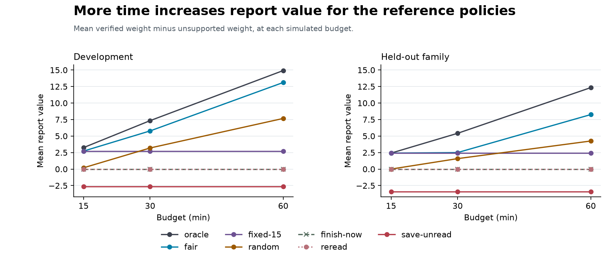
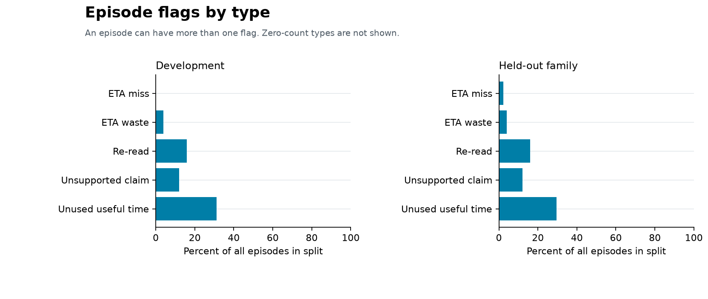

# Time Gym v2

**When an AI agent gets more time, does it deliver a better report? Can it estimate how long its own work will take?** Time Gym is a tool-use benchmark and a reinforcement learning environment for an RL hackathon application.

**Result:** On development cases, supervised fine-tuning (SFT) raised Qwen3.5-4B from **0.07 to 0.57** budget efficiency and from **0% to 54%** of oracle value at 60 minutes. On the held-out branch family, SFT scored **−0.02** and **13%**; the fair script scored **1.00** and **67%**. The small reinforcement learning run showed no clear gain over SFT on either split.

## Run the benchmark

Install [uv](https://docs.astral.sh/uv/) and use these commands from the repository root. They do not need an API key.

```sh
uv run --locked python -m unittest discover -s tests -v
uv run --locked python -m time_gym.report_baseline > dev.jsonl
uv run --locked python -m time_gym.report_baseline --split held-out > held-out.jsonl
uv run --locked --extra figures python -m time_gym.analysis dev.jsonl held-out.jsonl --output figures
```

Use the default split to develop policies and prompts. Reserve `--split held-out` for a final check. The development split has 36 cases from three families (seeds 0–11). The held-out split has 12 cases from a fourth family (seeds 100–111). We rebuilt that family after the first scripted run because both links led to the same record. We froze the revised benchmark before the second run. No model was tuned on either held-out set. The JSONL files record tool calls, draft scores, final drafts, and outcome types.

## Two tasks, one simulated clock

- **Fixed time.** Given 15, 30, or 60 minutes, deliver the highest-value verified report. Each case has 12–20 fictional topics with visible weights from 1 to 5. Even with perfect information, a full report took at least 212 minutes in the offline matrix. A read costs a hidden number of minutes within the catalog range. A failed read still costs time. The latest saved draft counts. A save costs one minute. A read that exceeds the budget gives no evidence.
- **Fixed scope.** Give an 80% ETA interval for your own work before reading. Then verify the three listed topics with no simulated deadline. The first verified save of all three topics stops the clock. An incomplete report has no observed completion time and earns zero reward.

A finding needs one current record from each stage, read before the save. Some records disagree. The last stage gives the deciding value. Cite the record that opens each gated record. In the held-out family, the two starting records lead to different records. One leads to an archived record, so the agent must go back if it takes that path. A failed or archived record cannot support a finding. Equivalent dates such as `18 May` and `May 18` earn the same credit; a separate counter records nonstandard format.

**Report value** is the sum of verified weights minus the sum of unsupported weights. **Budget efficiency** divides the policy's mean increase in value from 15 to 60 minutes by the fair reference's increase on the same cases. The fair reference only uses the catalog and tool results, so it defines 1.00. The oracle knows hidden costs and picks the highest-value set that fits. **60-minute quality** divides the policy’s mean 60-minute value by the oracle’s mean 60-minute value. Report both: gains can be large even if the final report is weak.

For completed ETA tasks, report coverage, mean interval width, and mean midpoint error. Positive error means the forecast was late. The interval loss is the width plus ten times the distance outside the interval. The reward is `20 / (20 + interval loss + 11 × waste minutes)`. Waste counts re-reads, failed-source retries, invalid actions, and extra saves. Time above the fair lookup is a separate metric and does not lower reward. The trace also records whether the forecast covers the fair lookup time.

## What the offline results show

There were **1,200 episodes**: 900 for development and 300 for the held-out family. Each case ran seven budget policies at three budgets and four ETA policies.

| Budget policy | Development value, 15 → 60 min | Held-out value, 15 → 60 min | Efficiency, dev / held-out | 60-min quality, dev / held-out |
| --- | ---: | ---: | ---: | ---: |
| Informed oracle | 3.25 → 14.92 | 2.42 → 12.33 | 1.12 / 1.70 | 100% / 100% |
| Fair reference | 2.72 → 13.11 | 2.42 → 8.25 | 1.00 / 1.00 | 88% / 67% |
| Fixed-15 control | 2.72 → 2.72 | 2.42 → 2.42 | 0.00 / 0.00 | 18% / 20% |
| Random plan | 0.19 → 7.67 | 0.00 → 4.25 | 0.72 / 0.73 | 51% / 34% |



The three budget test scripts for early finish, repeated reads, and saving without evidence earn zero or negative value. In 106 of 200 held-out topics, the cheapest initial link leads to a dead end.



The fair ETA covers 36 of 36 development cases and only 5 of 12 held-out cases. Its held-out interval is 38.2 minutes wide on average, and its midpoint is 22.75 minutes early. The 999-minute interval covers all completion times but earns only 0.020. The padding script completes at its predicted minute (180) in all 48 cases, but earns only 0.016 in development and 0.024 held-out. Its point forecast misses all 48 fair lookup times.


## Use the environment or the model runner

```python
from time_gym import ReportEnv

env = ReportEnv(family="chain", budget=60)  # Use budget=None for the ETA task.
brief, _ = env.reset(seed=42)
obs, reward, terminated, truncated, info = env.step('{"tool":"finish","args":{}}')
```

The reset observation gives instructions and the catalog. Actions are JSON text for `read_source`, `save_draft`, `finish`, and (ETA only) `estimate`. Keep prior tool responses in the agent's context. The budget task gives one terminal reward: final report value divided by total available weight. Terminal `info` gives the individual metrics. No Tinker integration or training is included.

After approval for a specific spend, the Inkling 2 Mini runner requires `--policy inkling`, `--allow-paid`, and `OPENROUTER_API_KEY`. Use `--reasoning on` or `off`, and `--samples` and `--sample-seed` for repeats. A budget episode allows 17, 32, or 62 requests at 15, 30, or 60 minutes. The ETA default is 120. These are request limits, not price limits. An API error, request limit, plain-text response, or output that cannot be parsed gets its own row. Later episodes still run. Provider support for the seed and reasoning settings is not verified live.

**Claim boundary:** Tool actions use simulated minutes; model inference uses none. These results check the scorer and controls on fictional tasks. They do not show that a model can use a real hour well or improve with training. Next, measure an untuned model on development cases. Test a prompt change if it shows a repeatable weakness. Keep held-out cases out of those decisions and test real-clock behavior separately.

## Qwen on Modal

The Qwen3.5-4B development baseline completed 48 episodes: three families, two case seeds, two sample seeds, and four tasks per case and sample. The model read sources and saved verified findings, but more time did not improve mean report value. The run used vLLM 0.19.0 with thinking off. No SFT, GRPO, or held-out model evaluation ran.

| Policy | 15 min value | 30 min value | 60 min value | Budget efficiency | 60-min value as share of oracle |
| --- | ---: | ---: | ---: | ---: | ---: |
| Qwen3.5-4B base | −0.17 | −1.67 | −1.75 | −0.18 | −13.1% |
| Matched fair reference | 1.83 | 4.17 | 10.50 | 1.00 | 78.8% |
| Matched oracle | 2.67 | 6.67 | 13.33 | 1.23 | 100% |

Eleven of 12 ETA episodes did not complete the scope. The one completion missed its ETA, had a 5-minute interval and 5 minutes of waste, and took 5 minutes longer than the fair lookup. Coverage is 0 of 1 among completed runs. The mean width across all 12 forecasts was 4.67 minutes.

Across all 48 traces, 44 episodes had an invalid action, 18 overran, 17 saved an unsupported claim, and 3 returned output that could not be parsed. These categories can overlap. The most common invalid actions were 409 rejected ETA calls (including calls in budget tasks or after an ETA was set), 142 rejected saves with invalid finding fields or citations, and 7 attempts to read a gated source before its link was open. No episode hit the request limit. The base model can use the tools, so there is no need to switch to Qwen3-8B.

| Job | Resource × measured function time | Estimated compute spend | Result |
| --- | --- | ---: | --- |
| [First baseline attempt](https://modal.com/apps/genr234/main/ap-uOoo8Hy6OCQHHwp254KNPF) | Planned L40S × 0 s | $0.00 GPU | CPU image build failed before a GPU started |
| [CPU image check](https://modal.com/apps/genr234/main/ap-eCKFxCuxzChcGNC2UGnWFt) | 2 vCPU and 4 GiB × 10.6 s | $0.00023 CPU and RAM | Imported both packages and found Qwen3.5 in the vLLM registry |
| [Development baseline](https://modal.com/apps/genr234/main/ap-SXTqXR4ap6WI4TecjO5Ch9) | L40S × 423.5 s | $0.23 GPU | 48 episodes complete |

Estimates use [Modal list prices](https://modal.com/pricing) and measured function time. They exclude container startup outside the function, CPU image builds, and other billing overhead. The full GPU client run took 441.8 seconds, or at most $0.24 if that entire time were charged at the L40S rate. The phase GPU cap is $25. The baseline uses one L40S, a 360-second startup limit, and a 1,500-second run limit, or about $1.01 at the L40S rate for both limits combined.

### Prompt-only control

The task-specific prompt removed the 409 rejected estimate calls on the original 48 episodes. But unparseable output increased from 3 to 32 episodes, often at the save step. The prompt change did not isolate time use from protocol errors. We kept the model, tools, parser, and sampling settings unchanged. This task-specific prompt is also used for SFT examples and is the prompt for later model comparisons.

| Prompt and subset | Mean value at 15 / 30 / 60 min | Budget efficiency | 60-min value as share of oracle |
| --- | ---: | ---: | ---: |
| Original, seeds 0–1, all | −0.17 / −1.67 / −1.75 | −0.18 | −13.1% |
| Task-specific, seeds 0–1, all | 0.00 / −0.42 / −1.08 | −0.13 | −8.1% |
| Task-specific, seeds 0–3, all | 0.00 / 0.63 / −0.63 | −0.07 | −4.6% |
| Original, seeds 0–1, no invalid actions | −2.00 / — / — | — | — |
| Task-specific, seeds 0–1, no invalid actions | 0.00 / 0.00 / 0.00 | 0.00 | 0% |
| Task-specific, seeds 0–3, no invalid actions | 0.00 / 0.00 / 0.00 | 0.00 | 0% |

The last two rows use 8 and 12 paired 15- and 60-minute runs for efficiency. Each 60-minute oracle comparison uses only the corresponding cases and samples. A parse failure can end an episode before the simulator records an invalid action. If we also exclude parse failures, neither prompt has a protocol-clean 60-minute episode. None of the 24 ETA episodes with the task-specific prompt completed the scope. Six raw traces are in [the sample](results/qwen-base-dev-sample.jsonl): three matched pairs selected to show an invalid action, an unsupported claim, and a verified finding in the original run.

The prior run gave a conservative estimate of $0.46 for twice as many episodes. The [prompt-only run](https://modal.com/apps/genr234/main/ap-ShTCJ7j9Wqgk3vRBNY5s2E) used one L40S for 281.2 seconds, an estimated $0.15 GPU spend. Total GPU spend through step 1b: $0.38, excluding startup.

### Constrained decoding and SFT

The Qwen comparison uses vLLM 0.19.0 structured output for both the base model and adapters. Each response must be one JSON action object with the fields for that tool. Budget tasks cannot call `estimate`. This controls for bracket and trailing-text errors in the time comparison. The final schema leaves the citation count to the simulator, along with citation validity and read overruns. The prompt and sampling settings did not change from the prompt-only run.

The supervised fine-tuning (SFT) job uses a rank-8 LoRA and 240 TRL optimizer steps. Its teacher is the fair policy. The training cases use development seeds 4–11. The model comparison uses seeds 0–3. Held-out cases are not used in either step. Training applies loss only to the assistant's next action and end token in the evaluation chat format.

With an approved Modal budget and configured credentials, run these steps in order. The last command loads the adapter in the same constrained evaluator as the base model.

```sh
uvx --with-editable . --from modal==1.6.4 modal run modal_time_gym.py::main --output qwen-base-dev-constrained.jsonl
uvx --with-editable . --from modal==1.6.4 modal run modal_sft.py::train
uvx --with-editable . --from modal==1.6.4 modal run modal_time_gym.py::main --adapter /cache/time-gym-sft-v1 --output qwen-sft-dev-constrained.jsonl
```

The [first SFT launch](https://modal.com/apps/genr234/main/ap-prqcCxQoeld37NFaI4ZBlq) was stopped before the constrained baseline. It loaded the model and prepared 697 examples, but logged no optimizer step or checkpoint. It used one L40S for 8.6 measured seconds, or about $0.005 in GPU spend. The SFT timeout plus startup limit caps a full run at about $1.50 in GPU spend.

| Qwen run, all episodes | Mean value at 15 / 30 / 60 min | Budget efficiency | 60-min share of oracle | ETA complete |
| --- | ---: | ---: | ---: | ---: |
| Original base, seeds 0–1 | −0.17 / −1.67 / −1.75 | −0.18 | −13.1% | 1/12 |
| Prompt-only base, seeds 0–3 | 0.00 / 0.63 / −0.63 | −0.07 | −4.6% | 0/24 |
| Citation-count-constrained base, seeds 0–3 | −4.42 / −7.50 / −12.79 | −0.88 | −93.6% | 6/24 |
| Syntax-only base, seeds 0–3 | −0.71 / 0.54 / 0.00 | 0.07 | 0.0% | 6/24 |
| Syntax-only SFT, seeds 0–3 | 1.96 / 3.00 / 7.42 | 0.57 | 54.3% | 19/24 |
| Matched fair reference | 2.08 / 4.83 / 11.58 | 1.00 | 84.8% | 24/24 |
| Matched informed oracle | 2.75 / 6.92 / 13.67 | 1.15 | 100% | 24/24 |
| Matched fixed-15 control | 2.08 / 2.08 / 2.08 | 0.00 | 15.2% | — |

On the 24 matched pairs, SFT added 5.46 value from 15 to 60 minutes, versus 0.71 for base: **+4.75 value in the gain**, or **+0.50 efficiency points** on the fair scale. The SFT gain is 7.71 times the base gain, but this ratio is sensitive because the base gain is small. Fixed-15 has no ETA policy; its row uses the 72 budget episodes only.

The constrained base produced 839 schema-valid actions and four incomplete 60-minute save actions. Unparseable episodes fell from 61 to 4. But episodes with unsupported claims rose from 12 to 69, and overruns rose from 23 to 33 (15 at the 15-minute budget). All 20 remaining invalid actions tried to read a gated source before its link was open. With zero invalid actions, mean values were −5.05 / −9.00 / −16.70, efficiency was −1.19 (20 matched pairs), and oracle share was −122.3%. Of six completed ETA tasks, two finished inside the forecast. Mean interval width and waste on those six tasks were 21.67 and 1.33 minutes.

The [constrained baseline](https://modal.com/apps/genr234/main/ap-Xm3wE16Y3NnLbjEka1dfk8) used one L40S for 384.3 seconds, or about $0.21. Estimated total GPU spend through this run, including the stopped SFT launch, was $0.59, excluding startup.

The first schema required two or three citations. That rule changed which errors could reach the simulator. The prompt-only run had 44 one-ID findings in rejected saves across 21 episodes. In 19 matched episodes, both runs took the same actions up to a save, then the first constrained run kept the topic, value, and first citation but added an unread citation. For example, one run changed `["05-41"]` to `["05-41", "05-48", "05-31"]`. The simulator rejected the first save but accepted and penalized the second. The trace audit counts each unsupported finding once, at the first failed check: unread source, failed or archived source, wrong topic, missing stage, wrong link, then wrong value. Counts across all accepted saves can include the same finding in several drafts.

| Unsupported cause in the first constrained run | Final drafts | All accepted saves |
| --- | ---: | ---: |
| Cites an unread source | 151 | 530 |
| Cites a failed or archived source | 5 | 9 |
| Stage missing | 46 | 51 |
| Value wrong after the evidence checks | 0 | 0 |
| Wrong topic or link | 0 | 0 |
| Total | 202 | 590 |

With the citation-count rule removed, all 834 actions matched the schema. No accepted save cited an unread source. The final drafts had 73 unsupported findings: 70 missing a stage and three citing a failed or archived record. The simulator rejected 120 saves for bad finding fields or citations; 56 episodes had at least one rejected one-ID finding. Overruns rose from 33 to 43, including 17 at 15 minutes. Among runs with no invalid actions, mean values were −1.00 / −1.33 / 3.50, efficiency was 0.35 on just two matched pairs, and oracle share was 23.3% on just two runs at 60 minutes. Treat those subset numbers with caution.

The [syntax-only baseline](https://modal.com/apps/genr234/main/ap-VBFlCsT3qeHHVbjrLKaVjK) used L40S × 329.8 s, or about $0.18. Cumulative GPU spend through this baseline was about $0.77, excluding startup and the SFT job still in progress at that point.

The [SFT training job](https://modal.com/apps/genr234/main/ap-mc8OuAnyxRPClPZ56uaISD) completed 240 steps and saved the adapter. It prepared 697 examples and measured a mean training loss of 0.0725. Training used L40S × 634.6 s, or about $0.34 excluding startup.

With the same syntax-only decoder, SFT raised budget efficiency from 0.07 to 0.57 and 60-minute value from 0% to 54.3% of the oracle. Both runs had zero parse failures. Invalid actions fell from 139 to zero and overruns fell from 43 to 11 (from 17 to 2 at 15 minutes). The SFT final drafts had 11 unsupported findings: eight that cited a failed or archived source and three missing a stage. Neither corrected run cited an unread source or had a wrong value after the evidence checks.

| ETA, completed tasks only | Coverage | Mean width | Mean waste | Mean time vs. fair lookup |
| --- | ---: | ---: | ---: | ---: |
| Syntax-only base | 2/6 | 20.83 min | 1.33 min | +0.33 min |
| Syntax-only SFT | 11/19 | 29.37 min | 0.00 min | −1.47 min |

SFT completed more ETA tasks and improved coverage, but the intervals were wider and coverage still fell short of the requested 80%. The two rows include different sets of completed tasks. The outcome shows improvement on development cases, not that the model generalizes to the held-out family. It also does not separate better tool use from better time decisions. GRPO and held-out model evaluation have not run.

The [syntax-only SFT evaluation](https://modal.com/apps/genr234/main/ap-m04Q23poWvWy6pvAqg0PPw) used L40S × 359.9 s, or about $0.20. Total measured GPU time for this phase was 2,421.9 L40S seconds, or about $1.31, excluding startup. The longest function was the SFT job at 634.6 seconds. No job was near $8.

### Budget-only group-relative training

Start from the SFT adapter. Sample eight complete episodes on the same case and budget, then use each episode's terminal reward minus the group mean, divided by the group standard deviation. One update uses fresh samples; there is no replay or separate value model. This is a single-step GRPO variant. The update uses the raw model token log probabilities for the policy-ratio gradient, but samples come from the schema-constrained decoder. Without the decoder mask or importance correction, the update is slightly off-policy. The 30 groups use only development seeds 4–11. ETA tasks are only evaluated, not trained in this pass.

The run checks all 96 development episodes at steps 15 and 30. It stops and rejects the checkpoint if mean budget reward rises but 60-minute value does not. The oracle denominator is fixed on these cases. The check also records re-read minutes, unused useful minutes, unsupported findings, and ETA waste. The GPU limit per job is one H100 for 5,400 seconds plus 360 seconds of startup, about $6.32 at the H100 list price of $0.001097 per second.

| GRPO job | GPU × function time | Estimated GPU spend | Result |
| --- | --- | ---: | --- |
| [Initial launch](https://modal.com/apps/genr234/main/ap-5tDwNI6FcVFcNstGNiYBPp) | H100 × 0 s | $0.00 | Image definition rejected before GPU allocation |
| [Shared environment](https://modal.com/apps/genr234/main/ap-nuZZ9u7uwwqsqJRcUeTlup) | H100 × 313.7 s | $0.34 | Incompatible vision dependency; no update |
| [Isolated trainer](https://modal.com/apps/genr234/main/ap-UdNz6w31YFvWKT8pxLb9Ke) | H100 × 275.5 s | $0.30 | Out of memory on group 3; no saved adapter |
| [Checkpointed trainer](https://modal.com/apps/genr234/main/ap-DF3kydAO1p2CUa8YZFTI33) | H100 × 2,595.4 s | $2.85 | Completed 30 groups and saved the adapter |

| Development checkpoint | Mean budget reward | 60-min value | Re-read min | Unused useful min | Unsupported findings | ETA waste min |
| --- | ---: | ---: | ---: | ---: | ---: | ---: |
| Base | 0.0036 | 0.00 | 0 | 21 | 73 | 8 |
| SFT | 0.0975 | 7.42 | 0 | 323 | 11 | 0 |
| GRPO step 15 | 0.0966 | 7.46 | 0 | 515 | 8 | 0 |
| GRPO step 30 | 0.0989 | 7.58 | 0 | 415 | 11 | 2 |

The stop rule did not trigger. At step 30, mean values at 15, 30, and 60 minutes were 1.96, 2.88, and 7.58. Efficiency was 0.59, and oracle share was 55.5%, up from 54.3% after SFT. ETA completion fell from 19/24 to 18/24, and coverage fell from 11/19 to 9/18. Mean interval width rose from 29.37 to 30.17 minutes and mean waste rose from zero to 0.11 minutes. The gain in report value is small; the unused time and ETA metrics regressed.

### Paired uncertainty intervals

The intervals use 20,000 bootstrap draws (seed 41). Each draw resamples whole cases within each family. Both sample seeds, both budgets, both models, and the two reference policies stay paired. Each draw uses its own fair gain and oracle value as denominators. There are 12 distinct cases per split, so the intervals do not measure variation across other families or independent training runs.

| Split and comparison | 60-min value difference [95% interval] | Efficiency difference [95% interval] | Oracle-share difference, percentage points [95% interval] |
| --- | ---: | ---: | ---: |
| Development, SFT − base | +7.42 [4.38, 10.50] | +0.50 [0.16, 0.85] | +54.3 [31.7, 77.5] |
| Development, GRPO − SFT | +0.17 [−1.92, 2.04] | +0.02 [−0.20, 0.21] | +1.2 [−13.8, 14.7] |
| Held-out, SFT − base | +0.63 [−1.58, 2.58] | −0.16 [−0.59, 0.21] | +5.1 [−12.3, 21.5] |
| Held-out, GRPO − SFT | −0.13 [−1.00, 0.63] | −0.02 [−0.16, 0.11] | −1.0 [−8.3, 4.8] |

The RL result is null on both splits: all six GRPO intervals include zero. This does not prove that the two adapters are equivalent. SFT improved all three development metrics, but none of its held-out budget intervals excludes zero. Recompute offline with `uv run --locked python -m time_gym.qwen_intervals <dev-or-held-out> <base.jsonl> <sft.jsonl> <grpo.jsonl>`.

### Frozen held-out settings

The held-out matrix uses branch seeds 100–111, sample seeds 41 and 42, three budgets, and an ETA task: 96 episodes per model. The first base attempt exceeded the 8,192-token context limit. We stopped the two adapter jobs without results and increased the limit to 32,768 for all three models. The weights, case split, prompt, schema, sampling, and simulator did not change. No partial scores were used. The failed base and stopped SFT and GRPO jobs used L40S × 458.8 s, 644.4 s, and 643.0 s respectively, or about $0.95 combined before startup charges.

Frozen weights: Qwen revision `851bf6e806efd8d0a36b00ddf55e13ccb7b8cd0a`; SFT adapter SHA-256 `ccd339ae7e2ed6bca3546cb00f64af9332a1dce67f1b010aeb1a6c5f0ca29a32`; GRPO adapter SHA-256 `4a55cd273a3e0a8df8b42ea82e495c167a5f0938a1143455452d10e0e84daf8c`.

| Held-out policy | Mean value at 15 / 30 / 60 min | Efficiency | 60-min oracle share | ETA complete |
| --- | ---: | ---: | ---: | ---: |
| Base | 0.17 / −0.08 / 1.00 | 0.14 | 8.1% | 2/24 |
| SFT | 1.75 / 2.38 / 1.63 | −0.02 | 13.2% | 11/24 |
| GRPO | 1.75 / 2.13 / 1.50 | −0.04 | 12.2% | 10/24 |
| Fair | 2.42 / 2.50 / 8.25 | 1.00 | 66.9% | 24/24 |
| Oracle | 2.42 / 5.42 / 12.33 | 1.70 | 100% | 24/24 |
| Fixed-15 | 2.42 / 2.42 / 2.42 | 0.00 | 19.6% | — |

| Held-out model | ETA covered / complete | Mean ETA width / waste (min) | Re-read min | Unused useful min | Unsupported findings | ETA waste min |
| --- | ---: | ---: | ---: | ---: | ---: | ---: |
| Base | 0/2 | 22.50 / 4.50 | 19 | 85 | 34 | 9 |
| SFT | 2/11 | 32.82 / 3.09 | 1,342 | 471 | 8 | 34 |
| GRPO | 2/10 | 31.60 / 3.00 | 1,706 | 515 | 10 | 30 |

ETA width and waste means use completed tasks only. Other columns are totals; ETA waste is observed only on completed tasks. There were no parse failures. Base, SFT, and GRPO had 50, 14, and 15 overruns, and 359, 605, and 543 invalid actions. The tuned models completed more ETA tasks but did not convert extra budget into more value on this family. The high re-read totals show repeated work, not evidence that the models learned to exploit the reward.

The completed held-out runs used three L40S jobs: [base](https://modal.com/apps/genr234/main/ap-IyBNI4vyS98P8312uQdB8f) × 457.4 s, [SFT](https://modal.com/apps/genr234/main/ap-VCco6bGjxANGa9bjNKpQ6H) × 769.9 s, and [GRPO](https://modal.com/apps/genr234/main/ap-ga5pK0vw12JXXyWMYqk3Re) × 858.8 s, or $1.13 combined. Total GPU spend for the phase was about **$6.88**, including failed and stopped jobs, at list rates and excluding startup. No job exceeded $8.

### Failure audit and progress-summary test

In the saved held-out runs, SFT and GRPO spent 1,135 and 1,461 simulated minutes on re-reads in ETA tasks, compared with 207 and 245 in budget tasks. Across both tasks, 777 and 924 of those minutes were spent on records already known to be archived. Attempts to read a gated record before opening its link accounted for 545 of 605 SFT invalid actions and 493 of 543 GRPO invalid actions. This shows a failure to track search progress, mainly in ETA tasks. It does not explain all of the budget gap.

We tested the same SFT adapter with and without a short progress summary. The comparison uses development seeds 12–15 in all three development families: 96 matched episodes per condition. Both conditions use the same budgets, decoding, sampling settings, and 32,768-token context. Only the last tool result in the prompt gets the summary. It lists observed record IDs, status, and links. The simulator and raw tool traces do not change. With approved Modal spend, run:

```sh
uvx --with-editable . --from modal==1.6.4 modal run modal_time_gym.py::main --progress-study --output qwen-progress-dev.jsonl
```

| Condition | 60-min value | Budget efficiency | 60-min oracle share | ETA complete | Gated read errors | Re-read minutes |
| --- | ---: | ---: | ---: | ---: | ---: | ---: |
| SFT, no summary | 8.75 | 0.62 | 54.4% | 15/24 | 0 | 0 |
| SFT with summary | 7.08 | 0.44 | 44.0% | 11/24 | 0 | 0 |

The control made no gated read errors and did not re-read records. Thus, this test could not show whether the summary prevents the held-out failure. All three paired 95% budget intervals include zero; the difference in oracle share was −10.4 percentage points [−28.7, +7.3]. Do not enable the summary by default. Before another paid test, make development cases that require recovery after an archived path. Keep the old held-out family frozen and use a fresh held-out family for any new transfer claim.

The [Modal job](https://modal.com/apps/genr234/main/ap-Xb48KGHKwpmrlW9b9Hm0dG) ran both conditions on one L40S for 497.7 seconds, or about $0.27 in GPU spend before startup. The full GPU estimate, including startup and run time limits, was below the approved $1.01 limit.

### Thinking-enabled training round

This round uses Qwen's native thinking template, a 1,024-token limit per action, and no guided decoding. The parser accepts one JSON action after the thinking block and counts invalid JSON as a parse failure. The SFT teacher generates 2,036 turns on seeds 20–79 across four development families. The new `detour` family has two-stage paths with failed or archived records. It does not change the original development evaluation or the frozen `branch` family.

The first [SFT attempt](https://modal.com/apps/genr234/main/ap-iqxHrnAM3cA7xKLEpbImRC) used H100 × about 128 billed seconds ($0.14). We stopped it at step 3 because the fallback kernels took about 21 seconds per step. It saved no adapter. The replacement uses pinned fast kernels. We use Modal's resource billing report and reserve the full timeout cost for active jobs before starting another job.

| Development run | 60-min value | Efficiency | Oracle share | ETA complete / covered | Parse failures | Re-read / ETA waste min |
| --- | ---: | ---: | ---: | ---: | ---: | ---: |
| Base, original prompt and temperature 1.0 | −0.21 | −0.02 | −1.5% | 0/24 / 0/24 | 86/96 | 0 / 0 |
| Base, short prompt and temperature 0.6 | 0.50 | 0.05 | 3.7% | 0/24 / 0/24 | 79/96 | 0 / 0 |
| SFT-v2, same evaluation settings as retry | 9.67 | 0.81 | 70.7% | 24/24 / 16/24 | 0/96 | 0 / 0 |

The [first base run](https://modal.com/apps/genr234/main/ap-drFXCX6Ciixosb0NHSEQ0f) used L40S × 620.4 s ($0.34 billed). Of its 86 failed episodes, 68 did not close the thinking block and 18 returned malformed or multiple actions after it. The [retry](https://modal.com/apps/genr234/main/ap-y2PQzHWZ5FThFh7uMkituD) requested short deliberation and one action at temperature 0.6, keeping the 1,024-token limit and no guided decoding. It used L40S × 574.9 s ($0.32 billed). In the retry, 52 episodes failed without a closed thinking block and 27 failed with invalid output after one. This is a protocol failure, not evidence of poor time decisions. Both base runs exceeded the 20% parse-failure gate. GRPO and held-out evaluation did not run.

The [completed SFT job](https://modal.com/apps/genr234/main/ap-J2vq1mrHn9XlDEMZGYicOX) trained all linear layers with rank 16 and alpha 32. It used 510 updates over two full epochs, an effective batch of eight, and cosine decay from 2e-4. It saved `/cache/time-gym-sft-v2`. The job used H100 × 1,918.8 s ($2.12 billed). This adapter trained with the original system prompt, before we added the short-deliberation instruction. Its development evaluation uses the same revised prompt and decoding as the base retry.

The [SFT evaluation](https://modal.com/apps/genr234/main/ap-ieAGOduusHpclQiExYkOdz) used `/cache/time-gym-sft-v2-text`. The export kept all 496 text tensors unchanged and removed 196 unused vision tensors after checking their LoRA B matrices were zero. The job used L40S × 339.3 function seconds ($0.17 billed). Two setup attempts used about 4 and 164 L40S billed seconds ($0.09 combined): the first could not import the SFT module, and the second could not load vision tensors into the text-only engine. Total project GPU spend was **$10.46** in Modal's billing report. No job reached $8.

| SFT-v2 minus base retry | Difference [paired 95% interval] |
| --- | ---: |
| 60-minute report value | +9.17 [7.58, 10.67] |
| Budget efficiency | +0.76 [0.58, 0.94] |
| 60-minute oracle share (percentage points) | +67.1 [55.6, 77.9] |
| ETA completion (percentage points) | +100.0 [100.0, 100.0] |
| ETA coverage across all ETA episodes (percentage points) | +66.7 [66.7, 66.7] |
| Re-read minutes per episode | 0 [0, 0] |

On the matched development run, SFT-v2 reduced unsupported findings from 5 to 0 and unused useful minutes from 1,358 to 20. The zero-width intervals describe the observed cases, not certainty about new cases. SFT improved end-to-end performance, but the base parse failures prevent us from separating protocol skill from time skill. Fix the base protocol on development cases before spending on GRPO. There are no new held-out results or transfer claims.

### ETA teacher and matched size comparison

The old fair forecast counted one read per stage plus a stage-1 reserve. A detour can waste the first gated path, so the interval ended early. The new forecast uses only the catalog. When two gated records share a stage, it adds one extra upper-bound read. It does not use hidden costs or that example's own completion time.

| Split | Coverage | Mean width (min) | Mean interval loss |
| --- | ---: | ---: | ---: |
| Detour seeds 20–79, old forecast | 0.23 | 34.9 | 157.7 |
| Detour seeds 20–79, recovery forecast | 0.97 | 66.7 | 67.4 |
| Detour seeds 80–99, not used to write the rule | 0.10 → 1.00 | 34.9 → 66.4 | 187.4 → 66.4 |
| Other families, seeds 80–99 | 0.97 → 0.97 | 35.6 → 35.6 | 36.5 → 36.5 |

Frozen branch seeds 100–111 were not used to choose the rule. Their old results stay as published. A later transfer test should use a fresh family, seeds 200–211, after the models are trained.

The next comparison has four arms. Both sizes use the same cases, scorer, budgets, prompt, temperature 0.6, 1,024-token limit, and no guided JSON. SFT uses the same corrected fair traces.

| Arm | Model | Revision |
| --- | --- | --- |
| 4B base | Qwen/Qwen3.5-4B | `851bf6e806efd8d0a36b00ddf55e13ccb7b8cd0a` |
| 4B SFT | same | same |
| 9B base | Qwen/Qwen3.5-9B | `c202236235762e1c871ad0ccb60c8ee5ba337b9a` |
| 9B SFT | same | same |

Both configs name `Qwen3_5ForConditionalGeneration` and the same thinking chat template. The 9B text hidden size is 4,096 and it has 32 layers. vLLM 0.19.0 already ran the 4B class. The 9B class is the same name, but this checkout has not loaded 9B on a GPU. Do not treat that as a compatibility proof.

Report the 60-minute value difference for tuned 4B minus base 9B, and each size's SFT minus base, paired by case. Keep ETA completion, coverage, width, and parse failures in separate columns.

```sh
uv run --locked python -m time_gym.size_compare
```

That command is local. It prints the forecast table and a mocked pairing. It does not call Modal.

A later GPU job should stay under $7.50. At the H100 list rate of $3.95 per hour, a 6,000-second timeout plus 360 seconds of startup is about $6.98. One 9B evaluation is larger than the 4B L40S run (339 seconds, $0.17). Budget three H100 jobs: one 9B SFT and two evaluations. Three jobs at the $6.98 ceiling are $20.94, which would pass the $25 project cap if added to the current $11.34. Stop before launch if billed spend plus that ceiling exceeds $25. No GPU compatibility claim is included.
